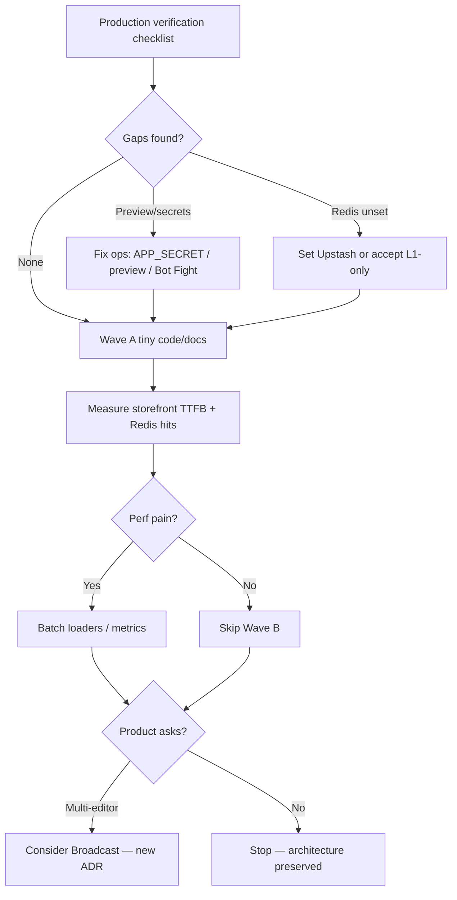

# Implementation Execution Plan — Theme Customizer & Storefront Cache

_Derived from [`TECHNICAL_ARCHITECTURE_AUDIT.md`](./TECHNICAL_ARCHITECTURE_AUDIT.md) and [`IMPLEMENTATION_STATUS.md`](./IMPLEMENTATION_STATUS.md) · 2026-11-09 · **Plan only** — no application code, migrations, or production changes in this deliverable._

Every recommendation below was re-checked against current source. Findings the audit overstated are explicitly **downgraded**. Optional product features are separated from bugs/ops gaps.

---

## 1. Executive Summary

The Pictocart theme stack is **already production-shaped**: App Router, JSONB `theme_versions`, Zod dual parsers, section registry + RSC renderers, React `historyReducer` + debounced autosave, iframe preview with signed tokens, draft/publish/rollback SQL, and optional Upstash Redis L2 behind `unstable_cache`.

**Do not rebuild** that architecture. **Do not** add Zustand or Supabase Realtime for themes unless product explicitly requires multi-editor collaboration. **Do not** put private dashboard data or rate limits on Redis without a new ADR.

| Classification | Count (after re-validation) | Action |
|---|---|---|
| P0 critical bugs | **0 verified** | None |
| P1 (ops / security review) | 1–2 | Production verification + small hardening |
| P2 improvements | Several | Measure first, then smallest fix |
| P3 polish / optional | Several | Defer or docs-only |
| Audit overstatements | 1 major | Embeds XSS — **not free HTML** (see §3) |

**Recommended first work after approval:** run [`PRODUCTION_VERIFICATION_CHECKLIST.md`](./PRODUCTION_VERIFICATION_CHECKLIST.md), then ship Wave A (ops + tiny code/docs fixes) only.

---

## 2. Verified Existing Functionality (do not rebuild)

| Capability | Evidence | Preserve |
|---|---|---|
| App Router + host rewrite | `src/proxy.ts`, `docs/ARCHITECTURE.md` | Yes |
| Tenant from host / membership only | `lib/tenant/resolve.ts`, `membership.ts` | Yes |
| Draft / published / archived | `theme_versions` + `publish_theme` / `rollback_theme` | Yes |
| Strict save / soft render | `parseThemeConfigStrict` / `resolveThemeConfig` in `schema/config.ts` | Yes |
| Section registry + RSC render | `sections/types.ts`, `render/sections.tsx` | Yes |
| Local-first editor + undo | `site-builder/history.ts`, `context.tsx` | Yes — **no Zustand** |
| Autosave 2.5s / max-wait 10s | `site-builder/autosave.ts`, `top-bar.tsx` | Yes |
| Optimistic concurrency | `baseUpdatedAt` + `CONFLICT` + Reload / Save anyway | Yes |
| Iframe preview + token | `preview.ts`, `protocol.ts`, `canvas-frame.tsx` | Yes |
| Publish → cache invalidate | `publishThemeAction` → `revalidateStorefront` | Yes |
| Optional Redis L2 public only | `lib/cache/redis.ts`, `public-cache.ts`, ADR-010 | Yes |
| Postgres rate limits | `lib/rate-limit.ts`, ADR-025 | Yes — **not Redis** |
| Structured theme embeds | `embedsSchema` = WhatsApp + backToTop only (`schema/site.ts`) | Yes |
| Map embed URL rebuild | `parseMapsEmbedUrl` + iframe in `sections-pages.tsx` | Yes |
| AI → draft only | Admin marketplace AI; seller `ai-section.ts`; publish explicit | Yes |

---

## 3. Finding Re-validation Matrix

Legend: **Bug** = incorrect/broken behavior · **Ops** = needs production check · **Product** = optional feature · **Overstated** = audit claim too strong vs code · **Keep as-is** = intentional design

| Audit item | Priority (audit) | Re-validated verdict | Type | Smallest safe next step |
|---|---|---|---|---|
| Cross-tenant theme write | (implied P0) | **Not found** | Keep as-is | Continue RLS + `requireTenant` discipline |
| XSS via “unconstrained HTML embeds” | P1 | **Overstated** — `embedsSchema` is structured widgets; RichText is plain text + `Paragraphs`; maps use rebuilt iframe URL | Ops / residual review | Spot-check `parseMapsEmbedUrl` + CSP is frame-ancestors only; no broad sanitize rewrite |
| Preview token / framing blank editor | P1 | **Valid ops risk** | Ops | Production checklist: mintVerify, preview preflight, Bot Fight Mode |
| No Realtime multi-tab sync | P2 | **Product gap**, not a bug — CONFLICT model works | Product / Keep | Document single-active-editor; **no Realtime** unless product asks |
| Dual CMS `pages` vs theme `pages` | P2 | **Product / UX debt** | Product | Docs/UI copy first; **no schema merge** without approved design |
| Redis optional / unknown hit rate | P2 | **Ops Not Verified** | Ops | Checklist env + metrics; no architecture change |
| Section render waterfalls | P2 | **Potential** — code has per-section `listProducts` etc. | Perf (unmeasured) | Measure TTFB first; then batch loaders if proven |
| Force-save clobber | P2 | **Mitigated in UI** — Reload / Save anyway already (`top-bar.tsx`) | Keep / tiny | Optional audit log on `force=1`; no UX rewrite |
| Public `store-assets` by path | P2 | **Intentional CDN model** for published media | Product / Accept | Document; signed URLs only if “private draft media” becomes a requirement |
| Preview token 2h bearer window | P2 | **Residual** by design | Ops | Keep TTL; document rotation of `APP_SECRET` |
| Tablet visibility | P3 | **Product** — only `desktop`/`mobile` in schema | Product | Document CSS breakpoints; add `tablet` only if sellers ask |
| AI marketplace vs live theme confusion | P3 | **Copy/docs** | Docs | Clarify AI → draft → publish in UI strings |
| History full snapshots | P3 | **By design** (≤256KB, limit 100) | Keep | Monitor; no change |
| `revalidateMarketplaceDemos` unused | P3 | **Verified** — defined, never called | Small bug/ops | Call on demo-origin writes **or** document TTL-only (300s) |
| Logo size cache untagged 7d | P3 | **Verified** — `storefront/server/logo.ts` | Small bug | Tag + invalidate on logo path change, or accept TTL (paths usually change on upload) |
| Legacy `ThemeEditor` unused | P3 | **Verified** — `editor/theme-editor.tsx` not imported by `/dashboard/theme` | Cleanup | Delete after import audit, or mark `@deprecated` |

---

## 4. Critical Issues

### 4.1 None verified as P0

No exploitable cross-tenant theme mutation path was re-confirmed in `theme/actions.ts` + RLS policies on `theme_versions`.

### 4.2 P1 — treat as ops-first, not rewrite

1. **Theme editor preview health (production)**  
   - Evidence: `preview.ts`, `api/theme/preview-token`, `api/cron/preview-token-self-test`, canvas preflight in `canvas-frame.tsx`.  
   - Risk: blank canvas if `APP_SECRET` skew, bot fight, or token/host mismatch.  
   - Fix: verification checklist + keep existing preflight/self-test gates. Code change only if a **measured** failure remains.

2. **Storefront script/HTML injection surface (reclassified)**  
   - Theme `embeds` are **not** free HTML.  
   - Residual: Contact map uses allowlisted URL rebuild; CSP today is mainly `frame-ancestors` (`lib/security/headers.ts`).  
   - Fix: security spot-check + document; expand CSP only with a careful allowlist plan (can break maps/third-party).

---

## 5. Recommended Improvements (priority sequence)

### Wave A — After production checklist (Small, low risk)

| ID | Work | Files likely affected | DB | API | Effort |
|---|---|---|---|---|---|
| A1 | Run / fix ops from checklist (Redis env, mintVerify, publish smoke) | Deploy secrets / CF / Supabase dashboard — **ops** | No | No | Small |
| A2 | Wire `revalidateMarketplaceDemos()` on demo-origin mutations **or** document TTL-only in ADR/docs | `theme/marketplace/cache.ts` + write sites if any; else docs | No | No | Small |
| A3 | Seller-facing copy: AI / marketplace apply does not publish live | Marketplace apply UI, theme top-bar help | No | No | Small |
| A4 | Document single-active-editor + CONFLICT UX | `docs/` + optional in-editor tip | No | No | Small |
| A5 | Optional: audit `force=1` draft saves | `theme/actions.ts` + audit helper | No | No | Small |

### Wave B — Measured performance (only if checklist shows pain)

| ID | Work | Files | Effort |
|---|---|---|---|
| B1 | Storefront TTFB / section waterfall profiling on heavy themes | `render/sections.tsx` (+ catalog loaders) | Medium |
| B2 | Batch product/collection fetches for section lists if B1 proves cost | `storefront/server/catalog.ts`, section renderers | Medium |
| B3 | Redis hit/miss logging (names only, no values) | `public-cache.ts` | Small |

### Wave C — Optional product (explicit approval required)

| ID | Work | Avoid unless |
|---|---|---|
| C1 | Tablet visibility flag | Sellers report tablet bugs |
| C2 | Unify CMS `pages` vs theme `pages` | Dedicated UX design approved |
| C3 | Supabase Realtime Broadcast for draft peer-save | Multi-editor collaboration is a roadmap item |
| C4 | Signed URLs for draft-only media | Confidentiality requirement for unpublished assets |
| C5 | Delete legacy `ThemeEditor` | Confirmed zero imports / no admin path |

### Explicitly avoid

- Replacing `historyReducer` with Zustand  
- Redis for dashboard lists, carts, sessions, or rate limits  
- Auto-publishing AI output  
- Rewriting draft/publish SQL model  
- Full CSP `script-src` lockdown without map/embed inventory  

---

## 6. Exact Files / Modules Affected (by wave)

| Wave | Modules |
|---|---|
| A (docs/ops) | `docs/*`, CF Worker secrets, Supabase Auth URL config, Upstash dashboard |
| A (code, if approved) | `src/features/theme/marketplace/cache.ts`, marketplace write actions (if demos mutable), marketplace/theme UI copy, `src/features/theme/actions.ts` (force audit) |
| B | `src/lib/cache/public-cache.ts`, `src/features/theme/render/sections.tsx`, `src/features/storefront/server/catalog.ts`, `src/features/storefront/server/logo.ts` |
| C | `schema/config.ts` (visibility), `site-builder/pages.ts`, new realtime hook (**not** recommended now), `editor/theme-editor.tsx` |

---

## 7. Database Changes

| Change | Required now? |
|---|---|
| New tables / columns for Realtime | **No** |
| Theme schema migrations for tablet | **No** (Wave C only) |
| RLS changes for themes | **No** unless checklist finds a policy gap |
| Signed URL / private bucket | **No** unless C4 approved |

Plan phase introduces **zero migrations**.

---

## 8. API Changes

| Change | Required now? |
|---|---|
| New public theme REST | **No** |
| Preview-token API | Keep; verify only |
| Publish / rollback Server Actions | Keep; no contract change in Wave A |
| Cache metrics endpoint | Optional Wave B (admin-only, no secrets) |

---

## 9. Frontend Changes

| Change | Wave |
|---|---|
| Copy / tips (AI publish, single editor) | A |
| None for Realtime/Zustand | — |
| Conflict UX | Already present — leave |
| Section data batching | B only if measured |
| Tablet controls | C only |

---

## 10. Testing Strategy

### Automated (existing gates)

- `pnpm check` after any code wave  
- Unit: `tests/unit` covering autosave, preview protocol, public-cache, theme schema (extend when touching those files)  
- RLS: `pnpm test:db` when touching policies (not in Wave A)

### New / focused cases per item

| Item | Test / acceptance |
|---|---|
| A2 demo revalidate | Unit: calling write path invokes `revalidateMarketplaceDemos` **or** documented TTL assertion |
| A5 force save | Unit/integration: `force=1` updates draft; without force, stale `baseUpdatedAt` → CONFLICT |
| B3 cache metrics | Log lines contain tag/prefix names only, never Redis payloads |
| Preview protocol | Existing protocol parse tests remain green |
| Embeds / maps | Unit: malicious map HTML rejected by `parseMapsEmbedUrl`; WhatsApp embed cannot inject script |

### Manual / production

See [`PRODUCTION_VERIFICATION_CHECKLIST.md`](./PRODUCTION_VERIFICATION_CHECKLIST.md).

---

## 11. Deployment and Rollback Strategy

| Step | Action |
|---|---|
| Pre-deploy | Checklist green: `mintVerify: ok`, Redis env present or consciously absent |
| Deploy | Existing vinext Worker path; **complete** secrets file (do not wipe `EMAIL_FROM` / Resend) |
| Theme code waves | Prefer feature flag or docs-only first; code behind normal CF deploy |
| Rollback | Previous Worker version + known-good secrets; theme data rollback via existing `rollback_theme` UI |
| Cache after incident | `revalidateStorefront(tenantId)` / `revalidateAllStorefronts()` as appropriate |

---

## 12. Estimated Effort

| Wave | Complexity | Notes |
|---|---|---|
| Production checklist | Small–Medium | Ops time, not eng architecture |
| Wave A code/docs | Small | Hours–1 day if demos write path exists |
| Wave B | Medium | Needs profiling evidence first |
| Wave C | Medium–Large | Product decisions required |

---

## 13. Priority-Based Implementation Sequence

1. **Verify production** (checklist).  
2. **Wave A** smallest fixes + docs.  
3. **Measure**.  
4. **Wave B** only with numbers.  
5. **Wave C** only with explicit product approval.  
6. **Implementation coding starts only after this plan is approved.**

---

## 14. Dependencies Between Improvements

| Item | Depends on |
|---|---|
| Wave B batching | Checklist + baseline TTFB |
| Realtime | Explicit multi-editor requirement + ADR; after CONFLICT docs (A4) |
| CMS/theme unify | Product design; not blocked by Redis |
| Logo cache tags | Optional; independent of Redis L2 |
| Demo revalidate | Independent; tiny |
| CSP expansion | Map/embed inventory; after embeds reclassification |

---

## 15. Acceptance Criteria (plan complete → ready to implement)

- [ ] Stakeholders accept **no P0 theme isolation bug** and **embeds XSS downgrade**.  
- [ ] Stakeholders accept **no Zustand / no theme Realtime** by default.  
- [ ] Production checklist executed (or scheduled) before Wave A code.  
- [ ] Wave A/B/C scope approved explicitly.  
- [ ] Any code PR references this plan and the audit evidence paths.

---

## Appendix — Evidence quick index

| Topic | Path |
|---|---|
| Save / publish / force | `src/features/theme/actions.ts` |
| Autosave / CONFLICT label | `src/features/theme/site-builder/autosave.ts`, `top-bar.tsx` |
| Embeds schema | `src/features/theme/schema/site.ts` |
| Map iframe | `src/features/theme/render/sections-pages.tsx` |
| Redis L2 | `src/lib/cache/redis.ts`, `public-cache.ts`, `storefront.ts` |
| Demo revalidate unused | `src/features/theme/marketplace/cache.ts` |
| Logo cache | `src/features/storefront/server/logo.ts` |
| Framing CSP | `src/lib/security/headers.ts` |
| Preview cookie | `src/features/theme/preview.ts` |
| Legacy editor | `src/features/theme/editor/theme-editor.tsx` |
