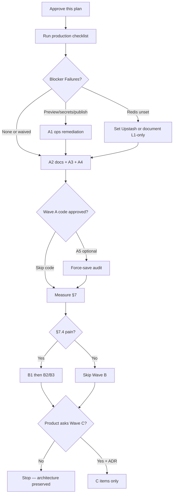

# Implementation Execution Plan — Theme Customizer & Storefront Cache

_Derived from [`TECHNICAL_ARCHITECTURE_AUDIT.md`](./TECHNICAL_ARCHITECTURE_AUDIT.md) and [`IMPLEMENTATION_STATUS.md`](./IMPLEMENTATION_STATUS.md) · 2026-11-09 · **Plan only** — no application code, migrations, or production changes in this deliverable._

_Final consistency review: 2026-11-09 — task cards completed; A2 demo-cache finding narrowed; mandatory vs optional separated; deploy safety expanded._

Every recommendation below was re-checked against current source. Findings the audit overstated are explicitly **downgraded**. Optional product features are separated from bugs/ops gaps.

---

## 1. Executive Summary

The Pictocart theme stack is **already production-shaped**: App Router, JSONB `theme_versions`, Zod dual parsers, section registry + RSC renderers, React `historyReducer` + debounced autosave, iframe preview with signed tokens, draft/publish/rollback SQL, and optional Upstash Redis L2 behind `unstable_cache`.

**Do not rebuild** that architecture. **Do not** add Zustand or Supabase Realtime for themes unless product explicitly requires multi-editor collaboration. **Do not** put private dashboard data or rate limits on Redis without a new ADR. **Do not** introduce microservices.

| Classification | Count (after re-validation) | Action |
|---|---|---|
| P0 critical bugs | **0 verified** | None |
| Mandatory before/with Wave A code | Ops checklist Pass (or documented waivers) | [`PRODUCTION_VERIFICATION_CHECKLIST.md`](./PRODUCTION_VERIFICATION_CHECKLIST.md) |
| Wave A (small) | Docs/ops + optional tiny code | After checklist |
| Wave B | Perf only if §7 measurements show pain | Blocked on checklist §7.4 |
| Wave C | Optional product | Explicit product approval |
| Audit overstatements | 1 major | Embeds XSS — **not free HTML** (see §3) |

**Gate:** Coding implementation starts only after (1) this plan is approved and (2) the production checklist is executed with Pass / documented N/A waivers for blockers. Docs-only Wave A items (A3, A4, A2-docs path) may proceed in parallel with checklist execution.

---

## 2. Verified Existing Functionality (do not rebuild)

| Capability | Evidence | Preserve |
|---|---|---|
| App Router + host rewrite | `src/proxy.ts`, `docs/ARCHITECTURE.md` | Yes |
| Tenant from host / membership only | `lib/tenant/resolve.ts`, `membership.ts` | Yes |
| Draft / published / archived | `theme_versions` + `publish_theme` / `rollback_theme` | Yes |
| Strict save / soft render | `parseThemeConfigStrict` / `resolveThemeConfig` in `schema/config.ts` | Yes |
| Section registry + RSC render | `sections/types.ts`, `render/sections.tsx` | Yes |
| Local-first editor + undo | `site-builder/history.ts`, `context.tsx` | Yes — **no Zustand** |
| Autosave 2.5s / max-wait 10s | `site-builder/autosave.ts`, `top-bar.tsx` | Yes |
| Optimistic concurrency | `baseUpdatedAt` + `CONFLICT` + Reload / Save anyway | Yes |
| Iframe preview + token | `preview.ts`, `protocol.ts`, `canvas-frame.tsx` | Yes |
| Publish → cache invalidate | `publishThemeAction` → `revalidateStorefront` | Yes |
| Optional Redis L2 public only | `lib/cache/redis.ts`, `public-cache.ts`, ADR-010 | Yes |
| Postgres rate limits | `lib/rate-limit.ts`, ADR-025 | Yes — **not Redis** |
| Structured theme embeds | `embedsSchema` = WhatsApp + backToTop only (`schema/site.ts`) | Yes |
| Map embed URL rebuild | `parseMapsEmbedUrl` + iframe in `sections-pages.tsx` | Yes |
| AI → draft only | Admin marketplace AI; seller `ai-section.ts`; publish explicit | Yes |
| Theme version history as rollback | Archived rows + `rollback_theme` UI | Yes — **backup model already exists** |

---

## 3. Finding Re-validation Matrix

Legend: **Bug** = incorrect/broken behavior · **Ops** = needs production check · **Product** = optional feature · **Overstated** = audit claim too strong vs code · **Keep as-is** = intentional design

| Audit item | Priority (audit) | Re-validated verdict | Type | Mandatory? | Smallest safe next step |
|---|---|---|---|---|---|
| Cross-tenant theme write | (implied P0) | **Not found** | Keep as-is | N/A | Continue RLS + `requireTenant` discipline |
| XSS via “unconstrained HTML embeds” | P1 | **Overstated** — structured embeds; RichText plain text; maps rebuilt URL | Ops spot-check | Checklist §6 | No sanitizer rewrite |
| Preview token / framing blank editor | P1 | **Valid ops risk** | Ops | **Yes — verify** | Checklist §2; code only if measured failure |
| No Realtime multi-tab sync | P2 | Product gap — CONFLICT works | Product | No | Document single-active-editor (A4) |
| Dual CMS `pages` vs theme `pages` | P2 | UX debt | Product | No | Copy first; no schema merge without design |
| Redis optional / unknown hit rate | P2 | Ops Not Verified | Ops | **Yes — verify or waive** | Checklist §1 |
| Section render waterfalls | P2 | Potential, unmeasured | Perf | No until §7.4 fails | Measure then batch (B1/B2) |
| Force-save clobber | P2 | Mitigated in UI | Keep / optional | No | Optional A5 audit log |
| Public `store-assets` by path | P2 | Intentional CDN | Product / Accept | No | Document only unless C4 |
| Preview token 2h bearer window | P2 | Residual by design | Ops | Document | Checklist §2; keep TTL |
| Tablet visibility | P3 | Product | Product | No | C1 only if sellers ask |
| AI marketplace vs live theme | P3 | Copy | Docs | Recommended | A3 |
| History full snapshots | P3 | By design | Keep | No | Monitor only |
| `revalidateMarketplaceDemos` unused | P3 | Verified unused; demos = code `SHOWCASE_STORES` + live open status (`marketplace/server.ts`) | Ops / docs | Recommended docs | Prefer **document 300s TTL**; wire invalidation only if status-change path is identified and approved |
| Logo size cache untagged 7d | P3 | Path-keyed `unstable_cache` in `storefront/server/logo.ts` | Small | No | Accept TTL (new upload = new path) or later tag |
| Legacy `ThemeEditor` unused | P3 | Not used by `/dashboard/theme` | Cleanup | No | C5 after import audit |

---

## 4. Critical Issues

### 4.1 None verified as P0

No exploitable cross-tenant theme mutation path was re-confirmed in `theme/actions.ts` + RLS on `theme_versions`.

### 4.2 Mandatory production verification (not architecture rewrites)

1. **Theme editor preview health** — Checklist §2 (`mintVerify`, mint API, preflight, Bot Fight Mode).  
2. **Redis posture** — Checklist §1 (present or conscious L1-only).  
3. **Publish → storefront** — Checklist §3.  
4. **XSS spot-check** — Checklist §6 (confirm embeds downgrade holds in prod render).

Code changes are **not** the first response to these; ops verification is.

---

## 5. Task Cards (objective · priority · dependencies · acceptance · validation)

### Mandatory ops (before Wave A *code*)

#### CHK — Production verification

| Field | Content |
|---|---|
| **Objective** | Establish measured baseline: preview, publish/cache, Redis, RLS, CONFLICT, XSS spot-checks, perf samples |
| **Priority** | P1 ops |
| **Dependencies** | Access to CF Worker, Supabase, a test seller store |
| **Acceptance** | Checklist signed; each section Pass / Fail / N/A / Not Verified; Failures that break editor or publish have remediation notes |
| **Validation** | [`PRODUCTION_VERIFICATION_CHECKLIST.md`](./PRODUCTION_VERIFICATION_CHECKLIST.md) sign-off table |
| **Mandatory** | **Yes** before Wave A application-code PRs |

---

### Wave A — Small / low risk

#### A1 — Remediate checklist Failures (ops)

| Field | Content |
|---|---|
| **Objective** | Restore preview/publish/secrets health without changing theme architecture |
| **Priority** | P1 |
| **Dependencies** | CHK |
| **Acceptance** | Previously Failed checklist items → Pass; `mintVerify: ok`; sample publish visible on storefront |
| **Validation** | Re-run checklist §§2–3; `/api/health/ready` |
| **Mandatory** | **Yes** if CHK failed; else N/A |
| **Files** | CF secrets / zone settings / Supabase Auth URLs — **not** app architecture |

#### A2 — Marketplace demo-origins cache policy

| Field | Content |
|---|---|
| **Objective** | Remove ambiguity around unused `revalidateMarketplaceDemos` |
| **Priority** | P3 |
| **Dependencies** | None (docs path); code path depends on identifying a tenant-status write that should invalidate demos |
| **Evidence** | `SHOWCASE_STORES` is a **code constant** (`marketplace/showcase.ts`); live openness from DB (`marketplace/server.ts`); helper unused (`marketplace/cache.ts`); catalogue writes already call `revalidateMarketplaceCatalogue` (`builder/actions.ts`) |
| **Acceptance (docs path — preferred)** | ADR-010 / deploy or theme docs state demo-origins may be stale ≤300s when a showcase store opens/closes |
| **Acceptance (code path — optional)** | On approved status-change mutation affecting showcase tenants, call `revalidateMarketplaceDemos()`; unit/assertion proves call |
| **Validation** | Docs review **or** unit test on wire-up |
| **Mandatory** | Docs path **recommended**; code path **optional** |

#### A3 — AI / marketplace apply copy

| Field | Content |
|---|---|
| **Objective** | Sellers understand AI/marketplace apply updates **draft**, not live storefront until Publish |
| **Priority** | P3 |
| **Dependencies** | None |
| **Acceptance** | Visible help near Apply / Theme Editor publish states the draft→publish rule |
| **Validation** | Manual UI review on `/dashboard/themes` and `/dashboard/theme` |
| **Mandatory** | Recommended (docs/UI copy only) |
| **Files** | Marketplace apply UI, theme top-bar help strings |

#### A4 — Single-active-editor documentation

| Field | Content |
|---|---|
| **Objective** | Document CONFLICT / Reload / Save anyway as the multi-tab model; no Realtime |
| **Priority** | P2 product clarity |
| **Dependencies** | None |
| **Acceptance** | Short doc (or in-editor tip) matches checklist §5/§8 expected behavior |
| **Validation** | Checklist §8.5 product sign-off can reference the doc |
| **Mandatory** | Recommended |
| **Files** | `docs/` and/or optional tip in `top-bar.tsx` |

#### A5 — Audit log on force draft save (optional)

| Field | Content |
|---|---|
| **Objective** | Trace intentional clobber when `force=1` |
| **Priority** | P2 optional |
| **Dependencies** | None |
| **Acceptance** | `force=1` success writes an audit event; normal saves unchanged |
| **Validation** | Unit/integration: stale without force → CONFLICT; with force → update + audit |
| **Mandatory** | **No** |
| **Files** | `src/features/theme/actions.ts`, audit helper |

---

### Wave B — Only if checklist §7 shows pain

#### B1 — Profile heavy storefront TTFB

| Field | Content |
|---|---|
| **Objective** | Produce evidence for/against section waterfalls |
| **Priority** | P2 |
| **Dependencies** | CHK §7.4 recorded |
| **Acceptance** | Written note: TTFB, waterfall, whether section product queries dominate |
| **Validation** | Browser/network or server timing artifacts attached to ticket |
| **Mandatory** | **No** — only if §7.4 regresses vs baseline or feels slow |

#### B2 — Batch section catalog fetches

| Field | Content |
|---|---|
| **Objective** | Reduce duplicate product/collection queries if B1 proves cost |
| **Priority** | P2 |
| **Dependencies** | B1 evidence |
| **Acceptance** | Fewer duplicate catalog queries on a fixed heavy page; `pnpm check` green; visual unchanged |
| **Validation** | Before/after query counts or TTFB; unit tests for batch helper |
| **Mandatory** | **No** |
| **Files** | `render/sections.tsx`, `storefront/server/catalog.ts` |

#### B3 — Redis hit/miss logging (names only)

| Field | Content |
|---|---|
| **Objective** | Observability for L2 effectiveness without logging payloads |
| **Priority** | P2 |
| **Dependencies** | Redis present (or skip) |
| **Acceptance** | Logs/metrics show hit/miss by prefix/tag **names**; no secret/body values |
| **Validation** | Code review + sample log redaction check |
| **Mandatory** | **No** |
| **Files** | `src/lib/cache/public-cache.ts` |

---

### Wave C — Optional product (explicit approval)

| ID | Objective | Priority | Dependencies | Acceptance | Validation | Mandatory |
|---|---|---|---|---|---|---|
| C1 | Tablet visibility flag | P3 | Product ask | Schema + editor + render honor `tablet` | Unit + device QA | No |
| C2 | Unify CMS vs theme pages | P2 | UX design | Single mental model; no data loss migration plan | Design review + migration rehearsal | No |
| C3 | Realtime draft peer-save | P2 | Multi-editor roadmap + **new ADR** | Second tab notified on peer save; no keystroke broadcast | Manual two-tab + RLS | No |
| C4 | Signed URLs for draft media | P2 | Confidentiality requirement | Unpublished assets not world-readable by path | Security review | No |
| C5 | Remove legacy `ThemeEditor` | P3 | Import audit | Zero references; `/dashboard/theme` unchanged | ripgrep + `pnpm check` | No |

---

### Explicitly avoid

- Replacing `historyReducer` with Zustand  
- Redis for dashboard lists, carts, sessions, or rate limits  
- Auto-publishing AI output  
- Rewriting draft/publish SQL model  
- Microservices split for theme rendering  
- Full CSP `script-src` lockdown without map/embed inventory  
- Wiring `revalidateMarketplaceDemos` “for completeness” with no call site that changes demo openness  

---

## 6. Exact Files / Modules Affected (by wave)

| Wave | Modules |
|---|---|
| CHK / A1 ops | CF Worker secrets, zone bot settings, Supabase Auth URL allow-list, Upstash dashboard |
| A2 docs | `docs/DECISIONS.md` or theme/deploy docs |
| A2 code (optional) | `theme/marketplace/cache.ts` + **existing** tenant status mutation module (only if identified) |
| A3–A4 | Marketplace/theme UI copy; `docs/` |
| A5 | `src/features/theme/actions.ts` |
| B1–B3 | Profiling artifacts; optionally `public-cache.ts`, `render/sections.tsx`, `storefront/server/catalog.ts` |
| C | `schema/config.ts`, `site-builder/pages.ts`, `editor/theme-editor.tsx`, etc. — **not started now** |

**Note:** Logo cache (`storefront/server/logo.ts`) is **not** in Wave B. It is path-keyed with 7d TTL; treat as P3 accept-or-later, not a batching dependency.

---

## 7. Database Changes

| Change | Required now? |
|---|---|
| New tables / columns for Realtime | **No** |
| Theme schema migrations for tablet | **No** (C1 only) |
| RLS changes for themes | **No** unless checklist §4 finds a gap |
| Signed URL / private bucket | **No** unless C4 approved |

**Zero migrations** in the plan/approval phase and in Wave A preferred path.

---

## 8. API Changes

| Change | Required now? |
|---|---|
| New public theme REST | **No** |
| Preview-token API | Keep; verify only |
| Publish / rollback Server Actions | Keep; A5 may add audit only |
| Cache metrics endpoint | Optional B3 alternative — prefer logs over new public API |

---

## 9. Frontend Changes

| Change | Wave | Mandatory |
|---|---|---|
| Copy / tips (AI publish, single editor) | A3/A4 | Recommended |
| Conflict UX | — | Already present — leave |
| Section data batching | B2 | No until measured |
| Tablet / Realtime UI | C | No |

---

## 10. Testing Strategy

### Automated (existing gates)

- `pnpm check` after any code wave  
- Extend unit tests when touching autosave, protocol, public-cache, theme schema  
- `pnpm test:db` only if RLS/policies change (not Wave A preferred path)

### Per-task validation

Embedded in §5 task cards (Acceptance + Validation columns).

### Manual / production

[`PRODUCTION_VERIFICATION_CHECKLIST.md`](./PRODUCTION_VERIFICATION_CHECKLIST.md) — required gate for Wave A **code**.

---

## 11. Deployment, Rollback, Backup, Monitoring Safety

| Concern | Existing capability | Plan requirement |
|---|---|---|
| **Backup (theme data)** | Immutable archived `theme_versions`; publish copies draft | Prefer rollback UI over DB restore; no extra backup job required for Wave A |
| **Backup (Worker)** | Prior CF Worker versions | Keep last known-good version id recorded at deploy |
| **Secrets safety** | Complete JSON secrets file; incomplete file **wipes** bindings | Never deploy 9-key subset; include `EMAIL_FROM` (+ Resend or DB-Resend waiver) — see `DEPLOY_CLOUDFLARE_WORKERS.md` |
| **Pre-deploy** | Checklist: `mintVerify: ok`, `/api/health/ready` | Mandatory before Wave A code deploy |
| **Deploy** | `pnpm build:vinext` + `cf deploy --prebuilt --secrets-file` | Unchanged architecture |
| **Post-deploy monitor** | Self-test, health/ready, one publish smoke, editor open | Checklist §3.7 within 15 minutes; §9 deploy safety when releasing Worker |
| **Rollback app** | Previous Worker version + known-good secrets | Document version id; do not rotate `APP_SECRET` during rollback |
| **Rollback theme content** | `rollback_theme` from Theme Editor history | Seller/support runbook |
| **Cache after incident** | `revalidateStorefront` / `revalidateAllStorefronts` | Ops may need a one-tenant revalidate after bad publish |
| **Feature flags** | Prefer docs-only first for A3/A4 | Code waves: ship behind normal review; avoid dual theme engines |

---

## 12. Estimated Effort

| Wave | Complexity | Notes |
|---|---|---|
| Production checklist | Small–Medium | Ops time |
| Wave A docs/copy | Small | Hours |
| Wave A optional code (A5 / A2 wire) | Small | Half day |
| Wave B | Medium | Only with §7 evidence |
| Wave C | Medium–Large | Product decisions |

---

## 13. Priority-Based Implementation Sequence

1. Approve plan.  
2. Run checklist (mandatory).  
3. Wave A docs/ops; optional tiny code.  
4. Measure.  
5. Wave B only with numbers.  
6. Wave C only with product + ADR where required.  

---

## 14. Dependencies Between Improvements

| Item | Depends on |
|---|---|
| A1 | CHK Failures |
| A3/A4 | None (parallel with CHK) |
| A5 | Plan approval |
| B1 | CHK §7.4 |
| B2 | B1 evidence |
| B3 | Redis present |
| C3 Realtime | Product multi-editor + **new ADR**; A4 docs first |
| C2 CMS unify | UX design — not blocked by Redis |
| Logo retag | Independent P3 — **not** tied to Wave B |

---

## 15. Consistency Notes (plan ↔ checklist)

| Topic | Plan | Checklist | Aligned? |
|---|---|---|---|
| Checklist before Wave A **code** | §1 gate + CHK task | How to use + §10 blockers | **Yes** (docs A3/A4 may parallel) |
| Deploy / rollback / secrets | §11 safety table | §9 deploy safety + §3.7 monitor | **Yes** |
| No live multi-tab merge | A4 / avoid Realtime | §8 expects no live merge | **Yes** |
| Embeds XSS | Downgraded | §6 confirms structured embeds | **Yes** |
| Wave B blocked on perf | B1 deps §7.4 | §7 + “Wave B blocked until 7.4” | **Yes** |
| Demo cache | Prefer document 300s TTL | §3.6 accept TTL or revalidate | **Yes** |
| Redis optional | Verify or L1-only | §1.1 | **Yes** |

---

## 16. Acceptance Criteria (plan approved → implementation may start)

- [x] Docs list mandatory vs optional tasks with objective, priority, deps, acceptance, validation (§5).  
- [ ] Stakeholders accept **no P0** and **embeds XSS downgrade**.  
- [ ] Stakeholders accept **no Zustand / no theme Realtime / no extra Redis scope** by default.  
- [ ] Production checklist executed with Pass or written waivers for Failures.  
- [ ] Wave A/B/C scope approved explicitly.  
- [ ] Any code PR references this plan + audit evidence paths.  

---

## Appendix — Evidence quick index

| Topic | Path |
|---|---|
| Save / publish / force | `src/features/theme/actions.ts` |
| Autosave / CONFLICT | `site-builder/autosave.ts`, `top-bar.tsx` |
| Embeds schema | `src/features/theme/schema/site.ts` |
| Map iframe | `src/features/theme/render/sections-pages.tsx` |
| Redis L2 | `src/lib/cache/redis.ts`, `public-cache.ts`, `storefront.ts` |
| Demo origins | `marketplace/showcase.ts`, `marketplace/server.ts`, `marketplace/cache.ts` |
| Catalogue revalidate (used) | `revalidateMarketplaceCatalogue` in `builder/actions.ts` |
| Logo cache | `src/features/storefront/server/logo.ts` |
| Framing CSP | `src/lib/security/headers.ts` |
| Preview cookie | `src/features/theme/preview.ts` |
| Legacy editor | `src/features/theme/editor/theme-editor.tsx` |
