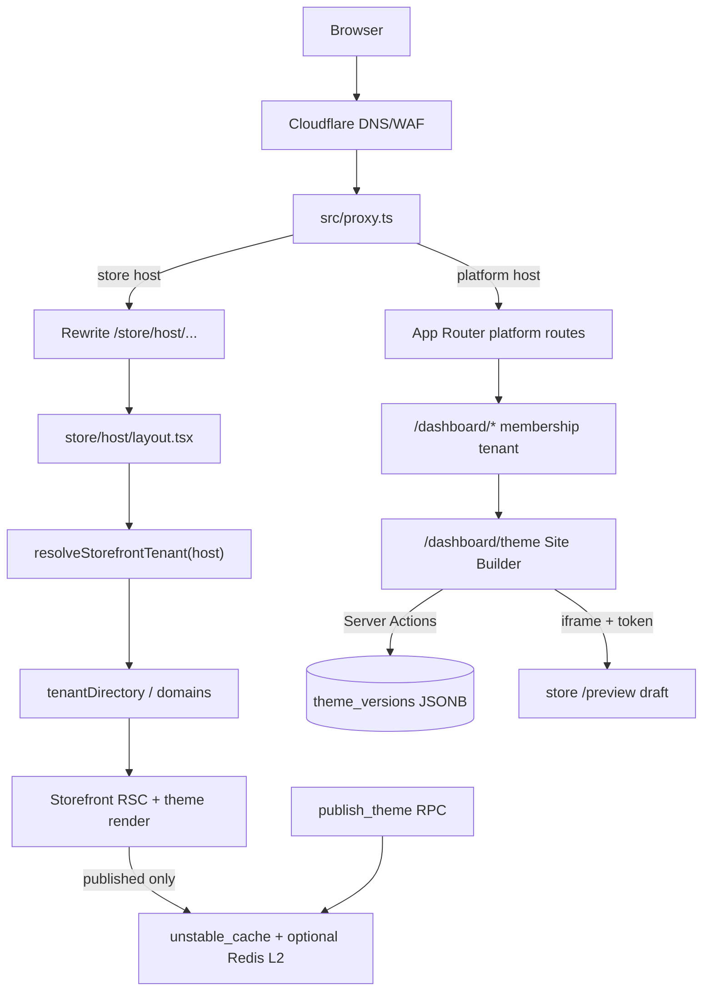
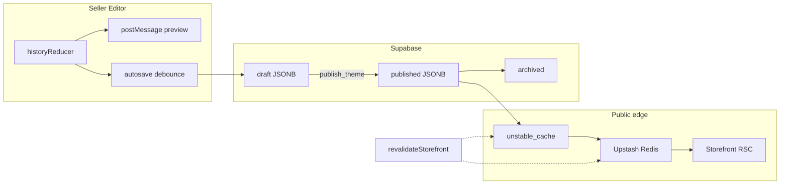

# Technical Architecture Audit — Theme Customizer & Platform

_Audit date: 2026-11-09 · Scope: codebase at repo tip (Next.js App Router + Supabase + optional Upstash Redis) · Mode: **read-only** (no application code or production config changes)._

This report verifies implementations from source, migrations, and ADRs. Items that could not be confirmed in code or SQL are marked **Not Verified**.

---

## 1. Executive Summary

Pictocart / The Paliya is a **modular monolith**: one Next.js **App Router** app serves platform (marketing, seller auth, dashboard, admin), multi-tenant storefronts (host-based), and APIs. Tenancy is enforced by verified host (storefront) or membership (dashboard), never by a client-supplied tenant id (`docs/ARCHITECTURE.md`, `src/proxy.ts`, `resolveStorefrontTenant`).

The **theme customizer** is already a configuration-driven engine:

- JSONB documents in `public.theme_versions` (one mutable `draft`, one `published`, archive history).
- Zod-validated schema (`src/features/theme/schema/config.ts`) with strict save vs soft render parsers.
- Central section registry + async Server Component renderers (`sections/types.ts`, `render/sections.tsx`).
- Site builder at `/dashboard/theme` with local history, debounced autosave, iframe live preview via signed preview token + `postMessage` (`site-builder/protocol.ts`).
- Publish / rollback via security-definer SQL (`publish_theme`, `rollback_theme`) + `revalidateStorefront`.

**Upstash Redis** is an **optional L2** behind Next `unstable_cache` for **public** storefront/catalogue reads only (ADR-010). Drafts and Live Preview are never cached. Rate limiting is **Postgres**, not Redis.

**Supabase Realtime is not used for theme sync.** The only verified Realtime consumer is the notifications bell (`use-live-notifications.ts`). Multi-tab theme sync is optimistic concurrency on draft `updated_at` (`baseUpdatedAt` / `CONFLICT`), not Broadcast.

Overall the theme stack is **production-grade for single-editor draft → publish**, with strong tenant isolation and fail-soft rendering. Gaps are primarily: no cross-tab/device live collaboration, no dedicated tablet visibility flag, Redis effectiveness **Not Verified** in production metrics, and AI theme generation is admin/marketplace-oriented (plus seller “Add with AI” section) rather than a full conversational theme co-pilot.

---

## 2. Existing Technology Stack

| Layer | Technology | Evidence |
|---|---|---|
| Framework | Next.js 16 App Router (`src/app/**`) | No `pages/` router; `docs/ARCHITECTURE.md` |
| Edge / host routing | `src/proxy.ts` (Node, host → platform vs `/store/[host]`) | ADR / Architecture §2 |
| UI | React Server Components + client islands | Storefront RSC; builder `"use client"` |
| Validation | Zod throughout | `schema/config.ts`, actions, env |
| DB / Auth / Storage | Supabase (PostgreSQL, Auth, Storage) | migrations, `lib/supabase/*` |
| Cache L1 | Next `unstable_cache` + tags | `lib/cache/public-cache.ts`, `storefront.ts` |
| Cache L2 | Optional Upstash Redis REST | `lib/cache/redis.ts`, env `UPSTASH_REDIS_*` |
| Rate limit | Postgres RPC `svc_rate_limit` | `lib/rate-limit.ts`, ADR-025 |
| AI | Multi-provider LLM via Neural Pulse (`generateJson`) | Anthropic / Gemini / Groq / NVIDIA; theme builder + seller AI |
| State (theme editor) | React context + `historyReducer` (not Zustand/Redux) | `site-builder/history.ts`, `context.tsx`; **no zustand in package.json** |
| Deploy | Cloudflare Workers (vinext) production origin | `docs/DEPLOY_CLOUDFLARE_WORKERS.md`, ADR-011 |

---

## 3. Existing Application Architecture



**Surfaces**

| Surface | Host | Tenant resolution |
|---|---|---|
| Marketing / seller / admin | `{root}`, `www`, aliases | N/A or membership / platform_memberships |
| Seller dashboard | platform host `/dashboard` | Active membership (`requireTenant`) |
| Storefront | `{slug}.{root}` / custom domain | Verified `domains` row; segment must match proxy host |

**Mutation contract:** `runAction` → `parseInput` (Zod) → auth → `assertPermission` → execute → audit (`docs/ARCHITECTURE.md` §6). Theme actions follow this in `src/features/theme/actions.ts`.

---

## 4. Existing Theme Customizer Architecture

### Entry

- Route: `src/app/dashboard/theme/page.tsx` → `getBuilderData` → `ThemeBuilderClient` → `SiteBuilder`.
- Permissions: `theme.edit` / `theme.publish` (`lib/permissions/matrix.ts`).

### Config model (JSONB)

Stored in `theme_versions.config` as documented in `schema/config.ts`:

```
{ schemaVersion, tokens, header, productCard,
  layout: { header[], footer[] },
  templates: { home, collection, product, collectionList, page, blog, search, cart, account },
  pages: [{ id, handle, title, seo…, sections[] }],
  popups[], menus{}, embeds, homePageId, builtinTitles }
```

Caps: `MAX_CONFIG_BYTES = 256 KiB`, `MAX_SECTIONS_PER_GROUP = 40`.

### What sellers can customize (verified)

| Capability | Support | Evidence |
|---|---|---|
| Section layout / type variants | Yes | Section definitions + design variants |
| Visibility (desktop / mobile) | Yes | `visibilitySchema` — **no separate tablet flag** |
| Section ordering / duplicate / hide / delete | Yes | Layers panel + canvas actions (`protocol.ts` `SECTION_ACTIONS`) |
| Background / text / accent per section | Yes | `sectionStyleSchema` |
| Global tokens (colors, fonts) | Yes | `schema/tokens.ts`, Theme panel |
| Font sizes / weights / text roles | Yes | `text-style` fields, `TEXT_ROLES` |
| Headings / body / CTA copy | Yes | Per-section settings + text select on canvas |
| Images / banners / video | Yes | Image/video fields; `uploadThemeImageAction` / `uploadThemeVideoAction` |
| Spacing / padding / margins / box | Yes | `schema/section-box.ts`, Size panel |
| Device preview (builder chrome) | Yes | Device toggle in site builder / section-size |
| Responsive logo / header CSS | Yes | `logo-layout.ts`, storefront CSS breakpoints |
| Theme-wide vs section settings | Yes | Theme panel vs section panel |
| Custom pages | Yes | `config.pages[]` at `/pages/<handle>` |
| Contact / About / etc. | Partial | Theme templates + Content CMS `pages` table merged in builder registry (`site-builder/pages.ts`) |
| Popups | Yes | `popups[]` + popup panel |

### Data flow (editor → DB → storefront)

```mermaid
sequenceDiagram
  participant Seller
  participant Builder as SiteBuilder history
  participant Canvas as Store iframe
  participant SA as saveThemeDraftAction
  participant DB as theme_versions draft
  participant Pub as publish_theme
  participant Cache as revalidateStorefront
  participant SF as Public storefront

  Seller->>Builder: apply/edit (local)
  Builder->>Canvas: postMessage theme+token
  Canvas->>Canvas: renderCanvasAction / draft cookie
  Builder->>SA: debounced Save draft (baseUpdatedAt)
  SA->>DB: update config JSONB
  Seller->>Pub: Publish
  Pub->>DB: archive old published; insert published
  Pub->>Cache: drop L1 tags + Redis index
  SF->>DB: load published (via cache)
```

### Live preview

- Signed, tenant-bound preview token (`createPreviewToken`, HMAC via `APP_SECRET`).
- Iframe loads store `/preview`; sets httpOnly `sf_preview` cookie; framing CSP allows platform origin (ADR-018).
- Host↔canvas protocol: `src/features/theme/site-builder/protocol.ts` (origin + source checks; token on theme messages).

---

## 5. Database Schema Analysis

### Core theme tables

| Object | Role |
|---|---|
| `public.theme_versions` | Per-tenant versions: `draft` \| `published` \| `archived`; `config jsonb` |
| Unique partial indexes | One draft and one published per `tenant_id` |
| `app.guard_theme_version` | Published/archived configs immutable |
| `publish_theme(p_tenant, p_label)` | SECURITY DEFINER; requires `theme.publish`; copies draft → new published |
| `rollback_theme(p_version)` | Re-publishes archived/published snapshot; resets draft config |
| `public.themes` | **Marketplace** presets (platform), not seller live themes |
| `public.pages` / `blog_posts` / `menus` | Content CMS (separate from theme JSON); builder can deep-link |

Evidence: `supabase/migrations/20260924000500_content_theme_analytics.sql`, `20261016003100_custom_marketplace_themes.sql`.

### RLS (theme_versions)

From migration 500:

- `theme_public`: anon/authenticated **SELECT** published rows when `app.tenant_is_open(tenant_id)`.
- `theme_staff_read`: SELECT if `theme.edit`.
- Draft INSERT/UPDATE: authenticated + `theme.edit` (and draft status constraints).

Publish/rollback go through SECURITY DEFINER RPCs that re-check `theme.publish`.

### Isolation assessment

- Dashboard writes always scoped with `eq("tenant_id", ctx.tenantId)` after `requireTenant()` (`actions.ts`).
- Asset paths must start with `tenant/{tenantId}/` (`assetsBelongToTenant`).
- Rollback verifies version belongs to active tenant before RPC.
- **Cross-store theme leakage via RLS alone:** public can only read **published** open tenants — intentional for storefronts. Drafts require `theme.edit` on that tenant.
- **P0 cross-tenant write:** Not found in audited mutation paths; still depends on membership resolution staying correct (existing platform invariant).

---

## 6. Real-Time Synchronization Analysis

| Concern | Current behavior | Verdict |
|---|---|---|
| Editor local state | `historyReducer` + React context; canvas paints from local config | Correct for single session |
| Live preview | `postMessage` + preview token; no DB round-trip per keystroke for paint | Correct |
| DB persistence | Debounced autosave 2.5s idle / 10s max-wait (`autosave.ts`) | Correct |
| Multi-tab sync | Optimistic concurrency on `updated_at` → `CONFLICT` / reload or force | Partial — no live merge |
| Multi-device sync | Same CONFLICT model after save | Partial |
| Supabase Realtime (theme) | **Not implemented** | Gap vs “collaborative live sync” |
| Realtime elsewhere | Notifications inbox channel + 60s poll fallback | ADR-036 area |
| Subscription cleanup | Notifications channel uses unique channel name | Theme N/A |
| Race / concurrent edit | `baseUpdatedAt` + force overwrite | Good for 2 editors; last-write-wins if force |
| Cache after publish | `revalidateStorefront(tenantId)` | Correct |
| Fetch DB after every edit | No — local-first; DB on autosave/publish | Correct |

**Zustand / Realtime Broadcast:** Not present for themes. Adding them is optional for multi-user collaboration; not required for current single-seller editor UX.

---

## 7. Redis Caching Analysis

| Topic | Finding |
|---|---|
| Client | `getRedis()` in `lib/cache/redis.ts`; no-op if env unset |
| Key pattern | `{prefix}:e:{name}:{encodedArgs}` e.g. `sf:v1:e:published-theme:{tenantId}` |
| Tag index | `{prefix}:idx:{tag}` sets for invalidation |
| TTL | Storefront `STOREFRONT_CACHE_SECONDS = 120`; index TTL = TTL+60 |
| Cached | Published theme, storefront profile/features, tenant directory, public catalogues (`pub:v1`) |
| Not cached | Drafts, Live Preview, dashboard/admin lists, cart/session, product/price/stock (ADR-010) |
| Invalidation | `revalidatePublicTags` → Next tags + Redis index delete; publish/rollback call `revalidateStorefront` |
| Fail-open | Redis errors / 300ms timeout → continue L1/DB |
| Rate limit | **Not Redis** — Postgres `svc_rate_limit` |
| Stale risk | If Redis unreachable during invalidation, L2 keys expire ≤ TTL (documented) |
| Prod hit rate | **Not Verified** (no metrics sampled in this audit) |

Duplicate layers: L1 (Data Cache) + L2 (Redis) are intentional, not conflicting duplicates.

---

## 8. Theme Rendering Analysis

| Question | Answer | Evidence |
|---|---|---|
| Centralized renderer? | Yes | `render/sections.tsx` + `SectionList` / `ThemeSlot` |
| Component registry? | Yes | `SECTION_TYPES` + definition map + renderer map (incl. `PAGE_SECTION_RENDERERS`) |
| Dynamic by type? | Yes | Type → async RSC renderer |
| Standardized config? | Yes | Zod schemas per section + envelope |
| Independent section settings? | Yes | `settings` + `style` + `box` + `visibility` |
| Global styles? | Yes | Tokens → CSS variables (`tokens-style.tsx`) |
| Unknown section types? | Soft-fail on render parse; skipped/invalid pieces drop | `resolveThemeConfig` |
| Invalid config breaks SF? | Save blocked by `parseThemeConfigStrict`; render uses soft resolve | Dual-parser design |
| Theme switch preserves content? | Marketplace apply keeps content, replaces style (`apply-marketplace.ts`, ADR marketplace) | Verified intent in code/docs |
| Responsive | Desktop/mobile visibility + CSS breakpoints; tablet shares phone/desktop rules | No `tablet` in `visibilitySchema` |

Configuration-driven engine **already exists**; recommend evolving it, not replacing it.

---

## 9. Draft and Publish Workflow Analysis

| Feature | Status | Evidence |
|---|---|---|
| Draft vs published | Implemented | `theme_versions.status` |
| Autosave | Implemented | Idle 2500ms, max-wait 10s, hold while dragging |
| Save status UI | Implemented | `draftStatusLabel` |
| Version history | Implemented | Archived versions + UI in top-bar |
| Publish | Implemented | RPC + permission + revalidate |
| Publish validation | Implemented | Re-parse draft strictly before RPC |
| Rollback | Implemented | `rollback_theme` + UI |
| Optimistic concurrency | Implemented | `baseUpdatedAt` / CONFLICT |
| Failed save recovery | Partial | Conflict UI reload/force; network errors toast |
| Autosave during conflict | Gated off | `shouldScheduleAutosave` |
| Named publish notes | Implemented | Optional label ≤80 chars |
| Full CRDT / OT merge | Not implemented | — |

Recommended workflow (largely already present):

`edit local → validate → autosave draft → publish validate → publish_theme → revalidateStorefront → SF reads published`.

---

## 10. Performance Analysis

**Measured in this audit:** none (no Lighthouse/CWV/API timing capture). Below are **code-derived risks**, not measured regressions.

| Area | Observation | Risk |
|---|---|---|
| Storefront | RSC + cached published theme (120s) | Low–medium if Redis unset (more Supabase load) |
| Theme editor | Full `ThemeConfig` snapshots in undo history (≤100, ≤256KB) | Memory OK by design; large themes approach cap |
| Live preview | postMessage + server `renderCanvasAction` for slots | Potential waterfall if every edit re-renders large slots — **Not Verified** frequency |
| Section renderers | Many async DB calls inside section components (`listProducts`, etc.) | Possible request waterfalls per page |
| Images | Storage + `next/image` / `/api/img`; Workers lack `sharp` | Soft-fail to originals on CF |
| Fonts | Theme font stacks; no `next/font/google` by ADR | Self-hosted / CSS stacks |
| Bundle | Site builder is client-heavy | Expected; keep renderers server-only (already split) |
| Redis | Optional; fail-open | Effectiveness **Not Verified** without env/metrics |

---

## 11. Security Analysis

| Issue | Severity | Notes |
|---|---|---|
| Tenant id from client | Mitigated | Host / membership only |
| Theme draft RLS + app checks | Mitigated | Dual layer |
| Publish RPC permission | Mitigated | `theme.publish` inside SQL |
| Asset path ownership | Mitigated | `assetsBelongToTenant` |
| Preview token binding | Mitigated | Tenant-bound HMAC; short-lived cookie |
| postMessage origin checks | Mitigated | Protocol validates origin/source |
| Env secrets | Mitigated | Zod server env; no secrets in client schemas |
| Redis credentials | Mitigated | Server-only env; unused if unset |
| XSS via theme HTML | Partial | Prefer structured fields; rich text paths need ongoing review — **spot-check Not Verified exhaustively** |
| Upload security | Mitigated | Tenant-scoped upload helpers + type checks (theme AI screenshots magic-byte check) |
| Rate limiting | Mitigated | Auth/theme AI use Postgres limiter; fails open |
| Cross-tenant draft read | Mitigated by RLS | Requires `theme.edit` on that tenant |

No **P0** cross-tenant theme write path was verified in this pass. Continued reliance on `requireTenant()` + RLS remains correct.

---

## 12. AI Integration Analysis

| Path | Role | Validation | Preview before publish |
|---|---|---|---|
| Super Admin theme builder | Generate marketplace theme from URL/screenshots | `generateJson` + theme build pipeline + Zod; rate limits | Saved as marketplace `themes` draft/active — sellers apply to **their** draft then publish |
| Site builder “Add with AI” | One section type+settings | `ai-section.ts` sanitises; media not taken from model | Inserts into local draft; seller still publishes |
| Seller AI suite | Catalog/coach/etc. (separate feature) | Own schemas | Not theme publish |

ChatGPT-branded single SDK: **Not Verified** as exclusive — code uses multi-provider Neural Pulse (`anthropic`, `gemini`, `groq`, `nvidia`).

Invalid AI output: repaired/sanitised or rejected; should not write published storefront without seller publish.

---

## 13. Existing Features Inventory

**Implemented (verified)**

- App Router multi-tenant host routing
- Draft / published / archived theme versions
- Site builder (pages, layers, theme, insert, popups, embeds)
- Section registry (~35 types) + designs/variants
- Debounced local-first autosave + undo/redo
- Iframe live preview + signed tokens
- Publish / rollback / history UI
- Marketplace theme apply (content-preserving)
- Storefront RSC rendering with soft config resolve
- Optional Redis L2 + tag invalidation
- Permissions `theme.edit` / `theme.publish`
- AI marketplace theme generation + AI section insert

**Partially implemented**

- Multi-editor collaboration (conflict only)
- Tablet-specific visibility (preview device ≠ separate visibility flag)
- Content CMS pages vs theme pages (merged UX, two storage models)
- Redis in all environments (optional)

**Not implemented (for theme)**

- Supabase Realtime Broadcast for drafts
- Zustand (or other global client store) for theme
- Automatic merge of concurrent draft edits
- Measured CWV dashboards in-repo for theme editor (**Not Verified** ops tooling)

---

## 14. Missing Features Inventory

| Feature | Status |
|---|---|
| Real-time multi-tab draft sync | Missing (CONFLICT only) |
| Presence / who is editing | Missing |
| Dedicated tablet visibility | Missing |
| Theme config compression / chunking beyond 256KB | Missing (hard cap) |
| Visual A/B of two published versions | Missing |
| Per-section experiment flags | Missing |
| Redis-backed rate limits | Intentionally not used |
| Full AI chat that mutates entire theme with undo stack | Partial (section + admin generator only) |

---

## 15. Identified Bugs and Architectural Problems

| Issue | Current Implementation | Evidence | Impact | Recommendation | Priority | Effort |
|---|---|---|---|---|---|---|
| No Realtime draft sync across tabs/devices | Local history + `baseUpdatedAt` CONFLICT | `actions.ts`, `autosave.ts`; no theme `.channel(` | Second tab overwrites or blocks; confusing multi-device | Document as single-active-editor; optionally Broadcast later | P2 | Medium |
| Tablet not a first-class visibility target | `visibility: { desktop, mobile }` | `schema/config.ts` | Tablet may show “desktop” sections unexpectedly | Add `tablet` or document CSS-only behavior | P3 | Small |
| Dual content models (CMS `pages` + theme `pages`) | Builder merges both | `site-builder/pages.ts`, migration `pages` table | Seller confusion; sync bugs possible | Clarify UX; one source of truth long-term | P2 | Large |
| Redis optional / effectiveness unknown | Fail-open L2 | `redis.ts`, ADR-010 | Cold starts may hammer Supabase if unset | Ensure prod env set; add hit/miss metrics | P2 | Small |
| Section render waterfalls | Per-section async catalog fetches | `render/sections.tsx` `Products` etc. | Slower TTFB on heavy templates | Batch loaders / dataloader pattern | P2 | Medium |
| Preview depends on token + third-party cookies / framing | Token-in-message mitigations exist | `protocol.ts`, preview docs | Editor blank if host/CSP/bot fight misconfigured | Keep preflight + self-test; ops checklist | P1 | Small (ops) |
| AI marketplace themes vs seller live theme confusion | `public.themes` vs `theme_versions` | migrations + builder | Wrong mental model for “AI changed my live site” | Docs/UI copy: AI → draft → publish | P3 | Small |
| History holds full documents | `HISTORY_LIMIT` 100 | `history.ts` | Memory/CPU on huge configs near 256KB | Structural sharing already; monitor | P3 | Small |
| Force-save can clobber peer edits | `force=1` on CONFLICT | `saveThemeDraftAction` | Data loss if misunderstood | Confirm dialog already; audit force saves | P2 | Small |
| XSS via unconstrained HTML embeds | `embeds` in config | `schema/site.ts` (embeds) | Storefront XSS if embed HTML trusted poorly | Strict allowlist / CSP; sanitize | P1 | Medium |

---

## 16. Recommended Architecture

**Retain**

- Next.js App Router + RSC storefront
- Supabase PostgreSQL + RLS + SECURITY DEFINER publish/rollback
- JSONB `theme_versions` + Zod dual parsers
- Central registry + Server Component renderers
- Local-first editor + debounced autosave + iframe preview
- `unstable_cache` + optional Redis L2 with tag invalidation
- `runAction` / permission matrix

**Improve (do not replace wholesale)**

- Observability for cache hit rate and publish latency
- Optional Realtime **Broadcast** for multi-tab dirty signaling (not full CRDT unless required)
- Clearer CMS-vs-theme page model
- Batch data loading in section renderers

**Do not add unnecessarily**

- Zustand (React history already fits single-editor)
- Redis for sessions/rate limits (Postgres ADR-025 is intentional)
- Separate microservices for theme rendering



---

## 17. Database Improvements

1. Keep immutable published versions (already).
2. Consider `theme_versions` size metrics / alert near 256KB.
3. Optional `editing_lease` row for soft single-editor lock (P2).
4. Retain RLS; add integration tests covering draft invisibility to anon (**partially covered by `tests/rls` — depth Not Verified**).
5. Document indexes already present; avoid redundant GIN on entire config unless query patterns appear.

---

## 18. API Improvements

1. Keep Server Actions for theme mutations (CSRF Origin via Next).
2. Ensure preview-token mint + self-test remain deploy gates (already ops practice).
3. Avoid new public REST that accepts `tenantId` from body.
4. Consider a read-only `GET` draft ETag for multi-tab poll if Realtime deferred.

---

## 19. State Management Improvements

1. Keep `historyReducer` — do **not** migrate to Zustand unless multi-surface sharing needs it.
2. If adding multi-tab: Broadcast “draft updated” → prompt reload; do not auto-merge blindly.
3. Continue coalescing typed edits (`COALESCE_MS`).

---

## 20. Caching Improvements

1. Confirm production `UPSTASH_REDIS_REST_URL` / `TOKEN` set (names only).
2. Emit metrics: L2 hit/miss, invalidation latency.
3. Keep drafts uncached.
4. Revisit product caching only after measuring free-tier (ADR already defers).

---

## 21. Real-Time Improvements

1. **Phase A:** Document single-active-editor + CONFLICT UX (cheap).
2. **Phase B:** Supabase Broadcast channel `theme-draft:{tenantId}` for “peer saved” events.
3. **Phase C:** Presence (optional).
4. Do **not** push every keystroke to Realtime/DB.

---

## 22. Security Improvements

1. Review `embeds` / rich text allowlists and CSP (`frame-ancestors`, script-src).
2. Audit force-save with audit log entries (if not already).
3. Keep admin client usage limited to ADR-006 paths.
4. Continue asset path tenant prefix enforcement.

---

## 23. Implementation Roadmap

### Phase 1 — Critical bugs & security
- **Changes:** Embed/CSP review; confirm preview token deploy gates; force-save confirmations.
- **Files:** `schema/site.ts`, security headers, `actions.ts`, preview routes.
- **Deps:** None.
- **Risks:** Over-tight CSP breaks embeds.
- **Acceptance:** No unverified HTML execution; preview self-test green.
- **Complexity:** Small–Medium.

### Phase 2 — Theme configuration architecture
- **Changes:** Document CMS vs theme pages; optional tablet visibility.
- **Files:** `pages.ts`, `visibilitySchema`, docs.
- **Deps:** Phase 1 optional.
- **Risks:** Migrating content pages is large — prefer clarify before migrate.
- **Acceptance:** Seller docs + schema notes; no data loss.
- **Complexity:** Medium–Large if unifying storage.

### Phase 3 — State management & live preview
- **Changes:** Keep history; improve canvas re-render scoping if profiling shows cost.
- **Files:** `canvas-bridge.tsx`, `protocol.ts`.
- **Deps:** Profiling.
- **Risks:** Over-optimising without metrics.
- **Acceptance:** Editor remains local-first; preview stays token-safe.
- **Complexity:** Medium.

### Phase 4 — Autosave & DB sync
- **Changes:** Already strong; add telemetry on CONFLICT rate; optional lease.
- **Files:** `autosave.ts`, `actions.ts`.
- **Acceptance:** CONFLICT rate visible; no silent clobber.
- **Complexity:** Small.

### Phase 5 — Supabase Realtime
- **Changes:** Optional Broadcast peer-save signals.
- **Files:** new hook under `site-builder/`, RLS/realtime publication config.
- **Deps:** Phase 4.
- **Risks:** Misconfigured Realtime auth.
- **Acceptance:** Second tab notified within seconds of peer save.
- **Complexity:** Medium.

### Phase 6 — Redis & invalidation
- **Changes:** Ensure env; metrics; verify publish clears L2 indexes.
- **Files:** `public-cache.ts`, ops docs.
- **Acceptance:** Hit rate logged; stale published theme &lt; 120s if invalidation fails.
- **Complexity:** Small.

### Phase 7 — Publishing & versioning
- **Changes:** Optional richer history labels/compare; keep SQL immutability.
- **Files:** top-bar history UI, RPCs if needed.
- **Acceptance:** Rollback restores draft+live; audit rows present.
- **Complexity:** Medium.

### Phase 8 — Performance & testing
- **Changes:** Batch section data loaders; CWV on storefront templates; expand unit/RLS tests.
- **Files:** `render/sections.tsx`, tests.
- **Acceptance:** `pnpm check` green; no invented CWV claims without measurement.
- **Complexity:** Large.

---

## 24. Priority-Based Action Plan

| Priority | Do first | Why |
|---|---|---|
| P0 | None verified for theme cross-tenant write | Isolation model looks sound |
| P1 | Embed/CSP review; preview/token ops reliability | Storefront XSS / blank editor |
| P2 | Redis prod confirmation + metrics; CONFLICT telemetry; section data batching; CMS/theme clarity | Scale & seller clarity |
| P3 | Tablet visibility; AI copy clarity; history tuning | Polish |

**Fix first:** keep production preview/publish path healthy (tokens, `APP_SECRET`, revalidation), then harden embeds/CSP, then observability on cache and conflicts. Defer Realtime until multi-editor is a real product requirement.

---

## 25. Final Recommendations

1. **Treat the current theme engine as the target architecture** — registry, JSONB, dual Zod parsers, draft/publish SQL, and local-first editor are already aligned with a production customizer.
2. **Do not assume Realtime or Redis “must” be expanded for correctness** — drafts are local-first; Redis is an optional public-read accelerator; Realtime is unused for themes by design today.
3. **Explain the real sync model to stakeholders:** live preview ≠ multi-user sync; publish + cache invalidation is how shoppers see changes.
4. **Instrument before rewriting:** cache hits, CONFLICT rate, preview render times, publish latency.
5. **Unify seller mental model** for Content pages vs Theme pages before a large schema merge.
6. **AI stays behind validation + draft** — never auto-publish AI output to the live storefront.
7. **Implementation only after explicit approval** of this audit’s prioritized phases.

### Critical problems (short list)

- Theme multi-tab collaboration is conflict-based, not realtime (product gap, not a silent security hole).
- Embeds / rich HTML need continued XSS discipline (P1 review).
- Preview/editor framing is operationally sensitive (tokens, CSP, bot fight).

### Missing features (short list)

- Realtime draft presence/sync; tablet visibility; measured cache/CWV dashboards; full AI chat co-edit.

### Unnecessary / duplicate implementations

- No Zustand duplicate of history (good).
- L1+L2 cache is intentional layering, not wasteful duplication.
- Marketplace `public.themes` vs tenant `theme_versions` are different domains — keep separate, clarify naming in UI.

---

## Appendix A — Key file index

| Area | Paths |
|---|---|
| Schema | `src/features/theme/schema/config.ts`, `tokens.ts`, `section-box.ts`, `site.ts` |
| Registry | `src/features/theme/sections/types.ts`, `definitions.ts`, `definitions-pages.ts` |
| Render | `src/features/theme/render/sections.tsx`, `slot.tsx`, `load.ts` |
| Builder | `src/features/theme/site-builder/**` |
| Mutations | `src/features/theme/actions.ts` |
| SQL | `supabase/migrations/20260924000500_content_theme_analytics.sql` |
| Cache | `src/lib/cache/storefront.ts`, `public-cache.ts`, `redis.ts` |
| Host routing | `src/proxy.ts`, `docs/ARCHITECTURE.md` |
| Realtime (non-theme) | `src/features/notifications/inbox/components/use-live-notifications.ts` |
| AI theme | `src/features/theme/builder/server/generate.ts`, `site-builder/ai-section.ts` |
| ADRs | `docs/DECISIONS.md` (ADR-010, 018, theme marketplace, fonts) |

## Appendix B — Audit method notes

- Source and migration inspection only; no production DB mutation; no dependency installs for the audit itself.
- Playwright/CWV/Redis hit rates were **not** measured in this pass.
- Secrets and env values are never reproduced here.
